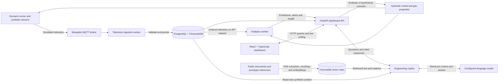

# System architecture

The prototype uses independently testable Python modules and a React dashboard. Docker Compose runs the broker, database, telemetry ingestion worker, FastAPI and dashboard, with one-shot schema and training services. The API replays recent observations through the hydraulic, analytics and maintenance modules.

## Component responsibilities

| Component | Responsibilities and implementation target |
| --- | --- |
| Scenario runner | Python, NumPy and Pandas. Generate reproducible scenarios and bounded streams of sensor readings. Write scenario truth to experiment outputs. |
| Gas properties and hydraulic model | Use Peng–Robinson, Darcy–Weisbach and finite-volume inventory. Isolate gas properties behind a tested interface so CoolProp can be evaluated later where suitable. |
| Telemetry transport and ingestion | Publish through Mosquitto. Validate schemas with Pydantic. Persist data quality and handle missing, late and duplicate messages. |
| State and event store | PostgreSQL with TimescaleDB hypertables for observations, and a relational table for saved risk reviews. |
| Analytics | Physics residuals and Scikit-learn, with XGBoost and PyTorch as additional model paths. Estimate anomalies, segment likelihood, maintenance priorities, and risk. |
| Optimization | Use SciPy to compare hypothetical operating points against simulated delivery constraints. |
| FastAPI | Provide read endpoints for dashboard state and history, scenario evaluation, risk review, and copilot questions. Serve snapshots and recent trends to a polling dashboard. |
| Dashboard | React, TypeScript, Tailwind CSS and Plotly. Provide Executive Overview, Digital Twin, Leak Detection, Energy Optimization, Predictive Maintenance, Safety and Risk, and Engineering Copilot views. |
| Copilot | LangChain text splitting, local latent-semantic embeddings and ChromaDB. Extract PDFs, index text with page provenance, retrieve before generation, and cite sources. |
| Deployment | Docker Compose for API, dashboard, database, broker, publisher, worker and the selected retrieval runtime. Use readiness checks and a one-shot schema migration. |

## Data contracts

- Each telemetry envelope carries schema version, run ID, source message ID, sensor ID, segment and boundary association, UTC observation time, typed value, unit, and quality. The ingestion worker records arrival time independently.
- Use MQTT QoS 1 on `prototype/telemetry/v1/{run_id}/{sensor_id}`. A deduplication constraint including the observation timestamp and message identity makes replay safe. Record rejected envelopes separately. Broker access uses isolated service credentials and topic permissions when deployed.
- Model outputs carry the telemetry time range, run ID, model or equation version, evidence, output timestamp, and quality. Raw observations persist independently of the dashboard, which can reconstruct the recent window after reconnecting.
- The dashboard presents quality flags and explicitly labels simulated readings. The client refreshes the current window to recover after a connection interruption. Scenario evaluation returns inputs, constraints, outputs and the model version.
- The copilot keeps source document citations distinct from current synthetic observations. The retrieval index records document title, revision, source URL, page, and content fingerprint. Treat extracted text as evidence. If retrieval finds insufficient evidence, give the user the available references and explain the gap.
- API calls and broker topics expose monitoring, assessment, and simulation. The prototype contains no route, topic, adapter, or copilot tool that can send commands to physical equipment. Record human acknowledgements as application events.

## Deployment and validation boundaries

The deployment target is a local Compose environment. Only the dashboard or gateway should be exposed by default. Keep database and broker on internal networks and persist data in named volumes. Use a configured trusted local or hosted text model when generated responses are required. Keep its credentials out of the repository. The GAIL proposal PDF, verified versions of regulations, and choice of generated-answer provider and public hosting target remain open.
